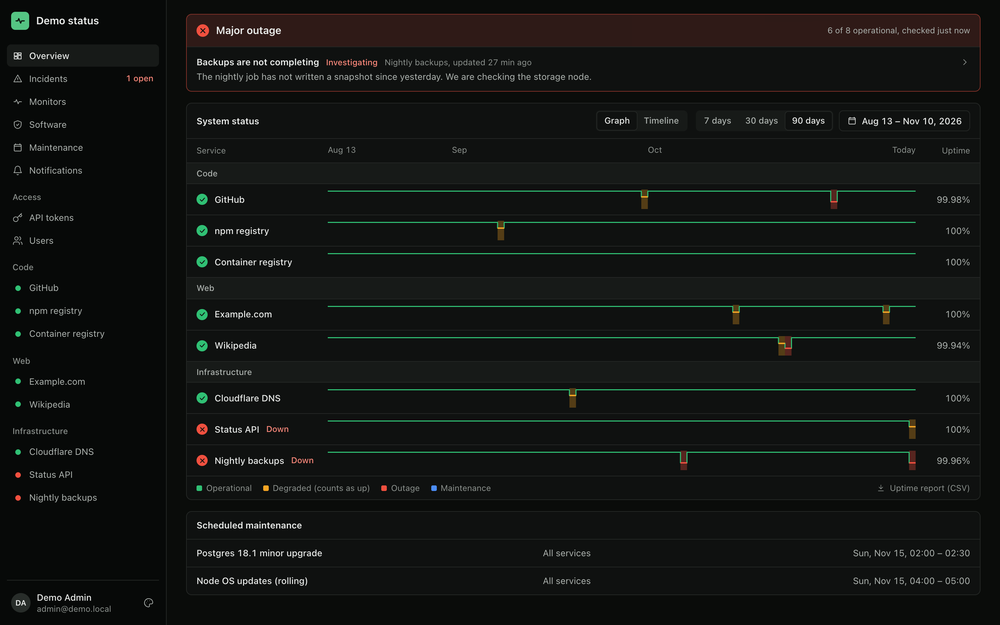
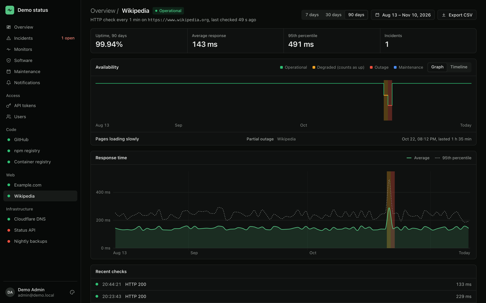
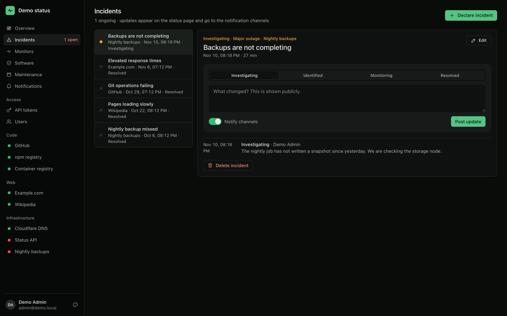

<div align="center">

# heartline

**A self-hosted status page for the services you run yourself.**

Uptime graphs, incidents and maintenance for your visitors. Monitors, alerts, software updates and an
MCP server for you. One container, one YAML file.

[](https://github.com/bircni/heartline/actions/workflows/ci.yml)
[](https://github.com/bircni/heartline/pkgs/container/heartline)
[](LICENSE)



</div>

## What you get

**For your visitors**

- 📈 **Uptime at a glance**: a graph per service over 7, 30, 90 days or any date range, with outages in red and degraded time in amber. A timeline view shows one bar per day instead.
- 📣 **Incidents and maintenance**: open incidents on top, a history with every update, scheduled windows, an RSS feed and CSV reports.
- 🎨 **Five colour themes**, dark and light, on desktop and phone.

**For you**

- 🩺 **Pull-based checks**: HTTP, TCP, DNS, TLS certificates, ICMP and exec **plugins** for anything else (backup age, queue length, a scripted login). Your services are never modified.
- 🛠️ **One sidebar for everything** once you sign in: incidents, monitors, maintenance, notifications, API tokens and users, next to every service.
- 🔔 **Alerts** to Microsoft Teams, e-mail and webhooks, with recovery notices and reminders.
- 🛡️ **Software inventory**: the running version of every service, the latest release, end of life and known vulnerabilities (OSV.dev, NVD, CISA KEV), scored from none to critical.
- 🔑 **Sign-in** with local accounts or Gitea / any OIDC provider, roles from groups, scoped API tokens.
- 🤖 **MCP server** at `/mcp`: ask your assistant what is down, declare incidents, schedule maintenance.
- 🗄️ **SQLite or Postgres**; with Postgres, run several replicas and one leader runs the checks.

<table>
  <tr>
    <td width="50%"></td>
    <td width="50%"></td>
  </tr>
  <tr>
    <td align="center">Every service: uptime, response times, incidents</td>
    <td align="center">Incidents with public updates</td>
  </tr>
</table>

## Quick start

```sh
docker run -d --name heartline -p 3000:3000 \
  -e BASE_URL=http://localhost:3000 \
  -e AUTH_SECRET="$(openssl rand -hex 24)" \
  -e ADMIN_PASSWORD=choose-a-long-password \
  -v heartline-data:/data \
  ghcr.io/bircni/heartline:latest
```

Open http://localhost:3000. Without a config file heartline monitors itself; sign in at `/login` as
`admin@example.com` (or `ADMIN_EMAIL`) with your `ADMIN_PASSWORD`, see
[`deploy/docker/status.yaml`](deploy/docker/status.yaml).

Then describe your own services in a `status.yaml` and mount it with
`-v "$PWD/status.yaml:/config/status.yaml:ro"`. It reloads on every change:

```yaml
site: { title: Homelab status, timezone: Europe/Berlin }

groups:
  - name: Code
    monitors:
      - { id: gitea, name: Gitea, type: http, url: https://git.example.com/api/healthz }
      - { id: postgres, name: Database, type: tcp, host: db.example.com, port: 5432 }

notifiers:
  - { id: teams, type: teams, webhookUrl: '${TEAMS_WEBHOOK_URL}' }

auth:
  users:
    - { email: you@example.com, name: You, password: '${ADMIN_PASSWORD}', role: admin }
```

[`status.example.yaml`](status.example.yaml) shows every option.

### Kubernetes

```sh
kubectl apply -k deploy/kustomize/overlays/sqlite     # one replica, SQLite on a PVC
kubectl apply -k deploy/kustomize/overlays/postgres   # two replicas, DATABASE_URL from the secret
```

Create the `heartline` Secret first ([example](deploy/kustomize/base/secret.example.yaml)). Run more
than one replica only with Postgres. Ping checks as non-root need the pod sysctl
`net.ipv4.ping_group_range: "0 2147483647"`. The container runs as UID 1000 with a read-only root
filesystem.

### Connect your assistant

```sh
claude mcp add --transport http status https://status.example.com/mcp
```

The client signs in through heartline (Gitea or a local account) and gets at most your role.

## Documentation

| Topic                                                     | What's inside                                                             |
| --------------------------------------------------------- | ------------------------------------------------------------------------- |
| [Configuration](docs/configuration.md)                    | `status.yaml`: site, monitors and their check types, notifiers, env vars  |
| [Software versions and vulnerabilities](docs/software.md) | Version probes, release sources, data sources, urgency scoring, privacy   |
| [Sign-in, roles and MCP](docs/auth.md)                    | Local accounts, Gitea/OIDC with role mapping, MCP tools by scope          |
| [HTTP API](docs/api.md)                                   | Public, software and admin routes; OpenAPI at `/api/v1/openapi.json`      |
| [Plugins](plugins/README.md)                              | Write a check in any language: exit code, JSON line, arguments            |
| [Development and releasing](docs/development.md)          | Local setup, tests, project layout, cutting a release with `pnpm release` |

## Development

Requires Node 26 and pnpm 12.

```sh
pnpm install
pnpm dev     # API on :3000 + UI on :5173, admin: admin@status.local / change-me-please
pnpm check   # lint, format, typecheck, test and build
```

More in [docs/development.md](docs/development.md).

## License

MIT, see [LICENSE](LICENSE).
